<p align="center">
  
</p>

<h1 align="center">Node Voyager</h1>

<p align="center">
  A native macOS OPC UA monitoring tool: browse address spaces, subscribe to tags and watch live telemetry from several servers at once.
</p>

<p align="center">
  
  
  
  
</p>

---

## Features

- **Multiple servers at once.** Configure any number of OPC UA servers in a connection dialog and connect or disconnect each one independently. Each connected server gets its own tree in the sidebar, and its live tags are tagged with the server name on the dashboard.
- **Node Pathfinder.** Browse the address space (Objects, Variables, Methods), search by tag name or node ID, and hover a row to see the full tag name and node ID. Subscribe to a variable with one click.
- **Live dashboard.** Each subscribed tag gets a metric tile with the current value, unit, quality, rate of change, a sparkline and min/avg/max. Select a tile to open a larger live chart with a crosshair, tooltip and value badge. The headline is the tag name, followed by the node ID in grey.
- **Resizable sidebar.** Drag the sidebar edge to resize it (the width is remembered). Double-click the edge to reset it.
- **Built-in simulator.** Use `mock://industrial-core` (or any `mock://` or `sim://` URL) to get a synthetic turbine, power-supply and coolant plant with no hardware or server.
- **Native look.** An overlay title bar and a flat, dark, terminal-style UI with a restrained green accent, designed for macOS.

## Tech stack

| Layer | Technology |
| --- | --- |
| Shell | [Tauri v2](https://tauri.app) |
| Backend | Rust 2021, [Tokio](https://tokio.rs), [`async-opcua`](https://crates.io/crates/async-opcua) client |
| Frontend | React 18, TypeScript (strict), Vite, Tailwind CSS, lucide-react |
| Target | `aarch64-apple-darwin`, macOS 12 or later |

## Architecture

```
┌─────────────────────────────────────────────────────┐
│  Frontend (React / TypeScript)                      │
│  Header · ConnectionsModal · NodeExplorer · Tiles   │
│  and Live chart                                     │
└───────────────┬─────────────────────────────────────┘
                │ Tauri IPC: invoke() + events
┌───────────────▼─────────────────────────────────────┐
│  Backend (Rust / Tokio)                             │
│  commands.rs · state.rs (connection map)            │
│  engine/ → OpcClient (real) | MockEngine (sim)      │
└───────────────┬─────────────────────────────────────┘
                │ opc.tcp://
        ┌───────▼───────┐
        │ OPC UA servers│
        └───────────────┘
```

- The backend keeps one session per connection in a map keyed by a connection ID. Each session owns its engine, a telemetry channel and a forwarder task.
- Telemetry records are tagged with their `connection_id` before they reach the webview, so several servers can stream into one dashboard.
- Series are keyed by `connectionId|nodeId`, so identical node IDs on different servers never collide.
- The frontend batches incoming samples and renders at about 10 Hz. Each series keeps at most 120 points.

### IPC reference

All backend calls are centralised in [`src/services/tauriClient.ts`](src/services/tauriClient.ts).

| Command | Arguments | Returns |
| --- | --- | --- |
| `connect_opcua` | `connectionId`, `endpoint`, `securityMode` | `ConnectionInfo` |
| `disconnect_opcua` | `connectionId` | `void` |
| `browse_node` | `connectionId`, `nodeId` | `NodeItem[]` |
| `subscribe_node` | `connectionId`, `nodeId`, `alias`, `intervalMs` | `bool` |
| `unsubscribe_node` | `connectionId`, `nodeId` | `bool` |

| Event | Payload |
| --- | --- |
| `telemetry-event` | Telemetry record with `connection_id`, `node_id`, `alias`, `value`, `data_type`, `status_code`, timestamps and `unit` |
| `connection-status-changed` | `connection_id`, `status`, `endpoint`, `message` |

## Getting started

### Prerequisites

- macOS on Apple Silicon
- [Rust](https://rustup.rs) (stable) with the `aarch64-apple-darwin` target
- [Node.js](https://nodejs.org) 18 or later and npm
- Xcode Command Line Tools (`xcode-select --install`)

### Run in development

```bash
npm install
npm run tauri dev
```

### Build a release bundle

```bash
npm install
npm run tauri build
```

The output is written to `src-tauri/target/release/bundle/`:

- `macos/Node Voyager.app`
- `dmg/Node Voyager_0.1.0_aarch64.dmg`

> **Linker error with a very new SDK?** If the build fails at the link step with `tapi error: malformed file` or `unknown architecture` in a `.tbd` file, the active macOS SDK is newer than your linker supports. Point the build at an older installed SDK:
>
> ```bash
> ls /Library/Developer/CommandLineTools/SDKs/
> SDKROOT=/Library/Developer/CommandLineTools/SDKs/MacOSX26.5.sdk npm run tauri build
> ```

### Other scripts

| Command | Purpose |
| --- | --- |
| `npm run dev` | Vite dev server only (port 1420, no Tauri shell) |
| `npm run build` | Type-check and build the frontend into `dist/` |
| `cargo check --manifest-path src-tauri/Cargo.toml` | Type-check the backend |

## Usage

1. Click **Connections** in the header.
2. Add a server: enter a name (optional), an endpoint and a security mode, then choose **Add** or **Add & connect**.
   - Live server: `opc.tcp://host:4840`
   - Simulator: `mock://industrial-core`
3. Expand the server in **Node Pathfinder**, hover a variable and click **Subscribe**.
4. Click a tile to inspect it in the large chart. Use the **x** on a tile to unsubscribe.
5. Repeat for additional servers. They appear side by side in the sidebar.

Connecting to the simulator subscribes automatically to four turbine tags (speed, vibration, temperature and pressure) so the dashboard fills immediately.

### Simulated address space

```
Objects
└── Plant
    ├── Turbine      Speed (RPM) · Vibration (mm/s) · Temperature (°C) · Pressure (bar)
    ├── PowerSupply  Voltage (V)
    ├── Coolant      Temperature (°C) · Pressure (bar)
    └── System       State
```

### Persistence

Server configurations (name, endpoint, security mode) and the sidebar width are stored in the webview's `localStorage`. No credentials are stored. Connection state and subscriptions are not restored on launch.

## Project structure

```
.
├── index.html
├── package.json
├── public/                   # logo-mark.svg
├── src/                      # React frontend
│   ├── App.tsx               # state, connection and subscription logic
│   ├── components/           # Header, ConnectionsModal, NodeExplorer,
│   │                         # MetricTile, TelemetryChart, charts/
│   ├── hooks/                # useTelemetryStream, useTauriEvent
│   ├── services/tauriClient.ts
│   └── types/
└── src-tauri/                # Rust backend
    ├── tauri.conf.json
    ├── icons/                # app icon set (source-icon.svg is the master)
    └── src/
        ├── lib.rs            # app setup, clean shutdown of sessions
        ├── commands.rs       # Tauri commands
        ├── state.rs          # per-connection state
        └── engine/           # client.rs (OPC UA), mock.rs (simulator),
                              # explorer.rs, mod.rs
```

## Known limitations

- The OPC UA client layer compiles and the simulator is exercised, but it has **not yet been tested against a real server**. Expect rough edges.
- Authentication is **anonymous only**. There is no username/password or certificate login yet.
- The client currently **trusts server certificates automatically** and uses a generated sample key pair. Do not use it against untrusted networks or for production security validation.
- "Sign" and "Sign & Encrypt" use the `Basic256Sha256` policy only.
- Automatic reconnect is not implemented yet. A dropped session has to be reconnected by hand.
- Only macOS on Apple Silicon is a supported target.

## Design

The visual language is flat: near-black surfaces (`#121212`), hairline borders (`#2e2e2e`), Snow text (`#fafafa`) and a single Phosphor Green accent (`#3ecf8e`). The logo is a hexagon enclosing a "V" built from three nodes. The bottom node is the live one. The app icon master is [`src-tauri/icons/source-icon.svg`](src-tauri/icons/source-icon.svg). To regenerate the icon set, render it to a 1024px PNG and run `npx tauri icon <png>`.

## Contributing

Issues and pull requests are welcome. Before opening a PR, make sure `npm run build` and `cargo check --manifest-path src-tauri/Cargo.toml` pass. Project conventions:

- Backend commands return `Result<T, String>` and never `unwrap()` in runtime handlers.
- All backend calls go through `src/services/tauriClient.ts`.
- Event listeners must be released on unmount.
- Live chart buffers stay capped.

## License

Node Voyager is open source under the [MIT License](LICENSE). Copyright (c) 2026 Ruwen Schneider.

It builds on third-party open-source software under MIT, Apache-2.0, MPL-2.0, BSD, ISC, Zlib and Unicode-3.0 licenses. See [THIRD_PARTY_LICENSES.md](THIRD_PARTY_LICENSES.md) for the full list, including notes on the MPL-2.0 and Unicode-3.0 obligations.

Key components:

| Component | License |
| --- | --- |
| [Tauri](https://github.com/tauri-apps/tauri) | Apache-2.0 OR MIT |
| [async-opcua](https://github.com/FreeOpcUa/async-opcua) | MPL-2.0 |
| [Tokio](https://github.com/tokio-rs/tokio) | MIT |
| [serde](https://github.com/serde-rs/serde), [chrono](https://github.com/chronotope/chrono) | MIT OR Apache-2.0 |
| [React](https://github.com/facebook/react) | MIT |
| [Lucide](https://github.com/lucide-icons/lucide) | ISC (parts MIT) |
| [Vite](https://github.com/vitejs/vite), [Tailwind CSS](https://github.com/tailwindlabs/tailwindcss) | MIT |
| [TypeScript](https://github.com/microsoft/TypeScript) | Apache-2.0 |

OPC UA is a trademark of the OPC Foundation. Node Voyager is an independent project and is not affiliated with or endorsed by the OPC Foundation.
